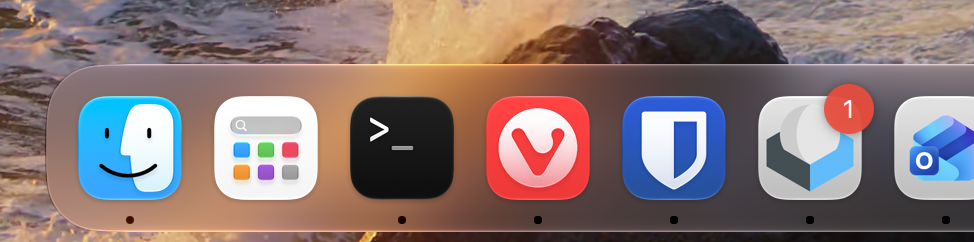

# App Badge for Roundcube

A small Roundcube plugin that mirrors the unread count in Roundcube's window title in the browser/PWA application badge. It uses the browser Badging API (`navigator.setAppBadge()` / `navigator.clearAppBadge()`).



## Installation

1. Copy the `app_badge` directory into your Roundcube `plugins/` directory.
2. Add `app_badge` to the `$config['plugins']` array in Roundcube's `config/config.inc.php`.
3. Sign in to Roundcube using a browser that supports the Badging API.

Example:

```php
$config['plugins'] = [
    // Keep your existing plugins here.
    'app_badge',
];
```

## Behavior and limitations

- The badge follows Roundcube's title prefix, such as `(3) Roundcube Webmail`, rather than counting a separately configured mailbox.
- The count is synchronized when the mail interface loads and whenever the title changes, including changes caused by marking messages read/unread, moving or deleting messages, and new mail.
- A title without an unread-count prefix clears the badge. Custom skins or plugins that change the prefix format may not be compatible.
- Only the main mail window updates the badge; embedded message frames do not.
- The plugin makes no additional IMAP requests and registers no server-side refresh hooks.
- Browser and operating-system support varies. The Badging API generally requires a secure context (HTTPS) and is most useful when the site is installed as a PWA.
- The plugin does not register a service worker or make Roundcube installable as a PWA; those are separate deployment concerns.
- If the browser does not expose the Badging API, the plugin does nothing.

## Troubleshooting

- After updating the plugin, reload Roundcube with the browser cache disabled so the updated JavaScript is loaded.
- In the browser console, check `window.isSecureContext`, `typeof navigator.setAppBadge`, and `typeof navigator.clearAppBadge`. The context must be secure and both methods must be available.
- Check `document.title` after the mail interface loads. A positive leading count such as `(3) ` calls `setAppBadge`; zero or no count calls `clearAppBadge`.

## Compatibility note

This plugin uses the Roundcube plugin API and observes title changes with `MutationObserver`. Its title-prefix format was checked against Roundcube 1.7.5. Test it on a staging instance first, especially if other plugins customize the window title.

## Tests

Run the JavaScript regression tests with Node.js 18 or newer:

```sh
node --test tests/app_badge.test.cjs
```
